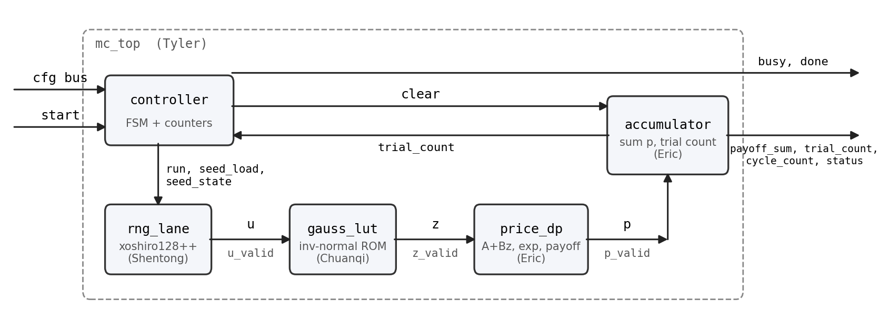

# Lane interface specification (DRAFT for team review)

_Status: proposal 2026-10-03; revised 2026-10-31 to match the merged RTL (`rng_lane`,
`gauss_lut`, `price_dp`, `accumulator`, `round_sat`, `mc_pkg`), all of which pass their
testbenches under VCS. Latencies in Section 6 are now measured. Decisions D-2, D-3,
D-5 and D-6 are closed in Section 9; D-4 waits on the multiplier area. Once the remaining points
are agreed, this file is the contract that `model/`, `rtl/`, and `tb/` are written
against. Shared constants live in `rtl/mc_pkg.sv`._

---

## 1. Purpose

One page that defines every signal between the blocks of a lane, the fixed-point
format on each one, the latency of each block, and how `valid` travels with the data.
Agreeing on this first is what makes the one-lane integration a wiring exercise
instead of a debugging exercise.



Blocks and owners: `rng_lane` (Shentong), `gauss_lut` (Chuanqi), `price_dp` = $x = A + Bz \rightarrow S_T = e^{x} \rightarrow p = \max(S_T - K, 0)$ and `accumulator` (Eric), `controller` + `mc_top` (Tyler).
Fixed-point formats and the rounding policy (Chuanqi) apply to all of them.

## 2. Global conventions

| Item | Rule |
|--------|------------------------------------------------|
| Clock | single `clk`; every block is fully synchronous to it |
| Reset | `rst_n`, active-low, asynchronous assert, synchronous de-assert (`rtl/rst_sync.sv` in `mc_top`; blocks never see the raw pin). All control state and `valid` bits reset; datapath registers are **not** reset (they load on a valid beat and are qualified by `valid`). See D-2 for the measured rationale and the constraints obligation |
| Handshake | **valid-only, no back-pressure.** Every stage accepts one item per cycle. `x_valid` is `in_valid` delayed by that block's latency. A stage must ignore its inputs when `valid=0` and must never assert its output `valid` for garbage |
| Throughput | one item per cycle per lane after fill (II = 1) |
| Latency | a compile-time `localparam LAT_<BLOCK>` in each block; `rtl/mc_pkg.sv` records the constants and the formulas for parameter-dependent ones (`lat_dp(MUL_STAGES)`, `lat_gauss(LATENCY)`, `lat_tree(LANES)`); the controller sizes the drain with `mc_pkg::lat_total(...)` |
| Fixed point | all formats below; one `round_sat` module for every narrowing; **round-half-to-even then saturate; no silent truncation**; saturation sets a sticky status flag |
| `round_sat` | `rtl/round_sat.sv`, combinational, `#(IN_WIDTH, OUT_WIDTH, SHIFT, SIGNED)`, ports `in`, `out`, `sat`. Drops `SHIFT` fraction bits with round-half-to-even, then clamps the **rounded** value to the output range and raises `sat`. The consumer places the register. Python twin `fxp.round_sat(x, shift, fmt)`; vectors `tb/vectors/round_sat_*.hex`, TB `tb_round_sat` |
| Constants | `rtl/mc_pkg.sv` (`import mc_pkg::*;`) is the single source for widths, `LAT_*`, `status` bit positions and the register map. Per-experiment knobs (`ADDR_BITS`, `EXP_ADDR_BITS`, `MUL_STAGES`, `LANES`, gauss `LATENCY`) stay module parameters |
| Naming | modules/files `snake_case`, parameters `UPPER_SNAKE`, `_n` active-low, `_valid` qualifiers, signed buses declared `logic signed` |
| Unknowns | no `x` on any `valid`-qualified bus after reset in simulation (assertion in `tb_mc_top`) |

## 3. Fixed-point formats (`Qi.f` = signed, `UQi.f` = unsigned; `i` excludes the sign bit)

| Symbol | Meaning | Format | Width | Range | Rationale |
|--------------|----------------|--------|-----:|------------------|---------------------------|
| `u` | uniform word | `uint32` | 32 | $[0, 2^{32})$ | RNG contract; high bits are the high-quality bits |
| `z` | standard normal | `Q3.12` | 16 | $\pm 3.30$ at `ADDR_BITS` $= 10$ | table-bounded: $\pm\Phi^{-1}(1 - 2^{-(a+1)})$; fraction bits beyond 12 do not change price error |
| `A` | $\ln S_0 + (r - \sigma^2/2)\,T$ | `Q5.12` | 18 | $\pm 32$ | $\ln 10\,000 = 9.2$; room for negative drift |
| `B` | $\sigma\sqrt{T}$ | `UQ2.14` | 16 | $[0, 4)$ | $\sigma$ up to $\approx 1.5$ at $T = 5$ y |
| `acc` | $(A \ll 14) + Bz$ fused sum | `Q5.26` | 34 | — | internal to `price_dp` S1, never stored; one register per `MUL_STAGES` |
| `x` | $\mathrm{round\_sat}_{18,14}(acc)$ | `Q5.12` | 18 | $\pm 32$ | $\exp$ input; **one** rounding of the whole sum (see 5.4); actual range is $A \pm 3.30\,B$ |
| `S_T` | $e^{x}$ | `UQ14.8` | 22 | $[0, 16\,384)$, step $2^{-8}$ | covers $S_0 \le 2\,000$ at $\sigma = 0.6$ with margin |
| `K` | strike | `UQ14.8` | 22 | same as `S_T` | compared/subtracted directly |
| `p` | payoff $\max(S_T - K, 0)$ | `UQ14.8` | 22 | same as `S_T` | no rounding: subtract and clamp |
| `payoff_sum` | $\sum p$ | `UQ46.8` | 64 (54 used) | $2^{32}$ trials $\times$ $2^{14}$ | 64-bit result register; overflow flagged |
| `trial_count` | accepted trials | `uint32` | 32 | | |

Software side (Python, double precision): $A = \ln S_0 + (r - \tfrac{1}{2}\sigma^2)\,T$,
$B = \sigma\sqrt{T}$, quantized with `Fxp(18,12)`, `Fxp(16,14,signed=False)`,
`Fxp(22,8,signed=False)`; price $= e^{-rT}\,\dfrac{\texttt{payoff\_sum}}{256\cdot\texttt{trial\_count}}$.

The alternative $S_T = C\,e^{Bz}$ (D-3) was rejected on 2026-10-22: with the
range-reduced exponential (D-6) the table size no longer depends on the input range,
so the extra multiply would buy nothing and would lose the fused $A$ add.

## 4. Top-level interface (`mc_top`)

A small write-only configuration bus plus parallel result outputs. This scales to
multiple lanes (per-lane seeds) without hundreds of ports and keeps the testbench
trivial.

| Signal | Dir | Width | Meaning |
|-------------|-----|-----:|--------------------------------------|
| `clk`, `rst_n` | in | 1 | see Section 2 |
| `cfg_we` | in | 1 | write strobe |
| `cfg_addr` | in | 8 | register address (map below) |
| `cfg_wdata` | in | 32 | write data |
| `start` | in | 1 | one-cycle pulse; ignored while `busy` |
| `busy` | out | 1 | high from `start` until `done` |
| `done` | out | 1 | one-cycle pulse when results are final (also sticky in `STATUS`) |
| `payoff_sum` | out | 64 | `UQ46.8`, valid after `done` |
| `trial_count` | out | 32 | accepted trials (= `N_TRIALS` unless aborted) |
| `cycle_count` | out | 32 | cycles from `start` to `done`, for throughput evidence |
| `status` | out | 8 | sticky flags: `[0]` done, `[1]` sat_x, `[2]` sat_S, `[3]` acc_overflow, `[4]` bad_cfg (e.g. zero seed, `N_TRIALS=0`) |

Register map (32-bit words; formats per Section 3, right-aligned, zero-extended):

| Addr | Name | Content |
|-----------:|-----------|-----------------------------------|
| `0x00` | `A` | `Q5.12` in bits [17:0] |
| `0x01` | `B` | `UQ2.14` in bits [15:0] |
| `0x02` | `K` | `UQ14.8` in bits [21:0] |
| `0x03` | `N_TRIALS` | `uint32`, total across all lanes |
| `0x10 + 4*i + w` | `SEED[i][w]` | state word `w` (0..3) of lane `i`'s xoshiro128 state |

Configuration is latched on `start`; writes while `busy` are ignored and set
`bad_cfg`. A run is a pure function of the register contents: same registers, same
`payoff_sum` and `cycle_count`, every time.

## 5. Inter-block interfaces

### 5.1 controller -> `rng_lane`

| Signal | Width | Meaning |
|-------------|-----:|------------------------------------------------|
| `seed_load` | 1 | one-cycle pulse; lane copies its four `SEED` words into state |
| `seed_state` | 128 | the four words, `{s3, s2, s1, s0}` |
| `run` | 1 | while high, emit one `u` per cycle; de-asserted by the controller after the last trial has been issued |

### 5.2 `rng_lane` -> `gauss_lut`

| Signal | Width | Format | Meaning |
|-----------|-----:|--------|------------------------------------------|
| `u` | 32 | `uint32` | one xoshiro128++ output word |
| `u_valid` | 1 | | `run` delayed by `LAT_RNG` |

Requirements: uniform over all $2^{32}$ values; one word per cycle; the all-zero state is
illegal (controller flags `bad_cfg`). For multi-lane, lane `i` is seeded by software
with $\mathrm{jump}^{\,i}$ of the root state (Vitis convention), so no jump hardware is needed.
`xoshiro128++` is preferred over `+` because the LUT consumes only the top bits and
`++` has no weak bits.

### 5.3 `gauss_lut` -> `price_dp`

| Signal | Width | Format | Meaning |
|-----------|-----:|--------|------------------------------------------|
| `z` | 16 | `Q3.12` | $\Phi^{-1}$ of the cell midpoint addressed by `u[31 -: ADDR_BITS]` |
| `z_valid` | 1 | | `u_valid` delayed by `LAT_GAUSS` |

$|z|$ is bounded by the table, which bounds $x$ and sizes the $\exp$ domain.
Reference: `model/gauss_lut.py`; RTL `rtl/gauss_lut.sv` (`LAT_GAUSS = LATENCY`
parameter, 1 or 2).

### 5.4 `price_dp` -> accumulator

| Signal | Width | Format | Meaning |
|-----------|-----:|--------|------------------------------------------|
| `p` | 22 | `UQ14.8` | $\max(S_T - K, 0)$ |
| `p_valid` | 1 | | `z_valid` delayed by `LAT_DP` |
| `sat_x`, `sat_s` | 1 each | | one-cycle pulses qualified by `p_valid`: `round_sat` saturated `x`, or `exp` clamped $S_T$ at $2^{14}$; made sticky in the accumulator |

Inside `price_dp` (as implemented, `rtl/price_dp.sv` + `rtl/exp2_unit.sv`; reference
`model/price_dp.py`):

| Stage | Operation | Format |
|---|---|---|
| S1 | $acc = (A \ll 14) + Bz$, fused multiply-add; `MUL_STAGES` registers for DC retiming | `Q5.26`, 34 b |
| S2 | $x = \mathrm{round\_sat}_{18,14}(acc)$ - **one** rounding of the whole sum, then saturate; `sat_x` | `Q5.12` |
| S3 | $y = x \log_2 e$ (constant multiply); $n = \lfloor y \rfloor$, `addr` = top `EXP_ADDR_BITS` of $y - n$ | |
| S4 | $2^f$ ROM at cell midpoints | `UQ1.16` |
| S5 | shift by $n$; round-half-even to 8 fraction bits; $n \ge 14 \rightarrow$ clamp, `sat_s` | `UQ14.8` |
| S6 | $p = S_T > K \;?\; S_T - K : 0$ (exact) | `UQ14.8` |

*Rounding note (2026-10-22, supersedes the first draft):* the first draft rounded $Bz$
and then added $A$. The implementation rounds the fused sum once, which differs by
1 LSB on exact ties when $A$ is odd and is slightly more accurate. The model and the
test `test_fused_rounding_tie_with_odd_a` define this behaviour.

### 5.5 accumulator and counter

- `payoff_sum <= payoff_sum + p` when `p_valid`; 64-bit; carry-out sets `acc_overflow`.
  (With $p < 2^{22}$ and at most $2^{32}$ trials the sum is $< 2^{54}$, so the flag is
  unreachable in practice; it is kept for the contract and tested with `SUM_WIDTH = 32`.)
- `trial_count <= trial_count + 1` when `p_valid` (multi-lane: `+ popcount(p_valid[LANES-1:0])`).
- **Sticky flags live here**: `sat_x_seen |= sat_x & p_valid`, `sat_s_seen |= sat_s & p_valid`,
  `acc_overflow`. `mc_top` maps them to `status[ST_SAT_X]`, `status[ST_SAT_S]`,
  `status[ST_ACC_OVF]` (bit positions in `mc_pkg`).
- All cleared by `clear` (driven by the controller on `start`); `clear` wins over a
  same-cycle add.
- Multi-lane: a registered adder tree sums the `LANES` payoffs first; it adds
  $\texttt{LAT\_TREE} = \lceil \log_2 \texttt{LANES} \rceil$ cycles and is part of `LAT_TOTAL`.

### 5.6 Controller sequence

```
IDLE  --start--> LOAD  (latch cfg, seed_load, clear sum/count/cycles)
LOAD  ---------> ISSUE (run=1; issued++ each cycle; run=0 when issued == N_TRIALS)
ISSUE ---------> DRAIN (wait until trial_count == N_TRIALS, or LAT_TOTAL cycles as a bound)
DRAIN ---------> DONE  (done pulse, status[0]=1, busy=0) --> IDLE
```

`cycle_count` counts from `start` to `done` inclusive. For `LANES > 1` the controller
issues $\lceil \texttt{N\_TRIALS} / \texttt{LANES} \rceil$ beats and masks the unused lanes in the final beat so
`trial_count == N_TRIALS` exactly.

## 6. Latency budget (measured under VCS, 2026-10-31; `rtl/mc_pkg.sv`)

| Block | `LAT_*` | `mc_pkg` | Notes |
|------------------|-----:|---|------------------------------|
| `rng_lane` | 1 | `LAT_RNG` | state update + output register |
| `gauss_lut` | 1 or 2 | `lat_gauss(LATENCY)` | ROM + negate in one stage; `LATENCY = 2` splits them. Both pass `tb_gauss_lut` |
| `price_dp` | 6 (`MUL_STAGES = 1`), 7 (`= 2`) | `lat_dp(MUL_STAGES)` = `MUL_STAGES + 1 + LAT_EXP + 1` | S1 (`MUL_STAGES`), S2 (1), S3-S5 (`LAT_EXP = 3`), S6 (1). Both pass `tb_price_dp` |
| adder tree | $\lceil \log_2 \texttt{LANES} \rceil$ | `lat_tree(LANES)` | 0 for one lane; not yet implemented |
| accumulator | 1 | `LAT_ACC` | result registers |
| **one-lane total** | **9** (defaults) | `lat_total(1, 1, 1)` | `rng 1 + gauss 1 + dp 6 + acc 1`; `lat_total(2, 1, 4) = 12` |

All blocks are II = 1 (one trial per cycle per lane after fill). Throughput goal:
$\texttt{N\_TRIALS} + \texttt{LAT\_TOTAL} + \approx 3$ cycles per run for one lane.

## 7. Python reference contract (`model/mc_lane.py`)

```python
run_lane(a, b, k, seed_state, n_trials, cfg=LaneConfig()) -> dict
    # {"payoff_sum", "trial_count", "acc_overflow", "sat_x", "sat_s"}  (result registers after done)
trace_lane(a, b, k, seed_state, n_trials, cfg) -> dict of per-trial arrays
    # u, z, acc, x, sat_x, s_t, sat_s, p   (raw ints at every block boundary)
run_option(s0, k, r, sigma, T, seed_state, n_trials, cfg) -> run_lane result + "price"
LaneConfig(gauss=GaussLutConfig(10,16,12), gauss_latency=1, dp=PriceDpConfig(), lanes=1).lat_total
```

`seed_state` is the 128-bit `{s3,s2,s1,s0}` bus or an `(s0,s1,s2,s3)` tuple; zero
raises. The module only chains the block owners' pure functions (`rng_lane.next_word`,
`GaussLut.lookup`, `price_dp.price_dp`, `price_dp.accumulate`); nothing is
re-implemented. `trace_lane` is what you diff against the waveform when `tb_mc_top`
reports a mismatch. `test_mc_lane.py` checks the stream against Shentong's cycle
model, the trace against Eric's stage functions, `lat_total` against `mc_pkg`, and
2^16-trial Monte Carlo convergence to the exact finite-table price.

## 8. Verification hooks every block must provide

| Block | Debug/observability requirement |
|-----------|----------------------------------------------|
| `rng_lane` | raw `u` stream exportable from simulation (for Shentong's stream tests) |
| `gauss_lut` | assertion: half-table magnitude never sets the sign bit; exhaustive-address vectors |
| `price_dp` | `sat_x`/`sat_s` pulses visible; directed vectors for `x` at the exp-table edges |
| accumulator | overflow assertion; test with `p = max` for $2^{20}$ trials |
| `mc_top` | `tb_mc_top` compares `payoff_sum`, `trial_count`, `status` with `run_lane`; checks `cycle_count` against the latency budget; asserts no `x` on valid-qualified buses |

## 9. Open decisions

| ID | Question | Options | Status | Owner |
|-----|-----------------|-----------------------|-------------------|----------|
| D-1 | Seed delivery for multiple lanes | (a) software writes 128 b per lane via cfg bus; (b) hardware jump from one root | **(a) implemented** in `rng_lane` (2026-10-13: `seed_load` + 128 b bus, no jump hardware). Software jump for lanes 2/4 still to be added to the model | Shentong, Tyler |
| D-2 | Reset style | async-assert/sync-deassert vs fully synchronous | **Closed 2026-10-31: async-assert / sync-de-assert**, as implemented in all blocks. Lab 3 guidance says "synchronous only; no async flop in the library", but gscl45nm's `DFFSR` is fully characterised (clear/preset arcs, recovery and removal constraints, LEF and sim model present). Measured cost is nil: a reset flop is `DFFSR` 10.32 um^2 either way vs `DFFPOSX1` 7.98 + `AND2X1` 2.35 = 10.33 for a synchronous reset. Benefits kept: reset without a running clock, no gate in the D path, standard ASIC practice. Obligations we take on: (1) only `valid`/control flops are reset, data flops are not (area); (2) `rtl/rst_sync.sv` in `mc_top` aligns de-assertion; blocks never see the raw pin; (3) `rst_n` is timed as a normal input in `constraints/lane_5ns.sdc` so DC/PT check recovery/removal - never false-path it; (4) P&R must buffer the reset tree (Week 7 risk item) | Chuanqi (decision), Tyler (`mc_top`/P&R) |
| D-3 | $S_T = e^{A+Bz}$ vs $C\,e^{Bz}$ | see Section 3 | **Closed 2026-10-22: $e^{A+Bz}$.** Range reduction (D-6) makes the table size independent of the input range, so $C e^{Bz}$ would add a multiplier and lose the fused $A$ | Eric, Chuanqi |
| D-4 | `z` width | `Q3.12` (16 b) vs `Q3.8` (12 b) | Open. 16 b implemented. Model says fraction bits do not change price bias (Gaussian plan Sec. 6); decide on `gauss_lut` + `B*z` multiplier area from the Week-3 synthesis sweep (`results/gauss_lut_ppa.csv`) | Chuanqi, Eric |
| D-5 | `A`/`x` width | 18 b `Q5.12` vs 16 b `Q5.10` | **Closed 2026-11-01: keep 18 b `Q5.12`.** Exact-bias study (`model/d5_x_width_study.py`, Gaussian plan Sec. 6.2): `Q5.12` costs 0.01-0.05 % on the grid; `Q5.10` costs up to 0.37 % because the one-time rounding of `A` is amplified by $\partial P/\partial A \approx S_0 N(d_1)$. If a 16-bit `x` is ever needed for area it must be `Q4.11` (same bias as `Q5.11`; $x$ outside $\pm 16$ is already clamped/underflowed by `exp2_unit`), never `Q5.10` | Chuanqi, Eric |
| D-6 | `exp` implementation | direct table on `x` vs range reduction + fractional table | **Closed 2026-10-22: range reduction** ($2^{y}$, $y = x\log_2 e$; `EXP_ADDR_BITS` entries of `UQ1.16`, default 10, 8 under consideration). Direct table would need $\approx 65$k entries | Eric |
| D-7 | Top-level bus | cfg write bus (Section 4) vs all-parallel ports | cfg bus; register map constants in `mc_pkg` | Tyler |
| D-8 | `N_TRIALS` not a multiple of `LANES` | lane mask on last beat vs require multiple | lane mask; `accumulator` already counts `popcount(p_valid)` | Tyler |

Decisions get recorded here with the date; the Python model, RTL, and vectors are then
regenerated from the agreed values rather than patched by hand.
