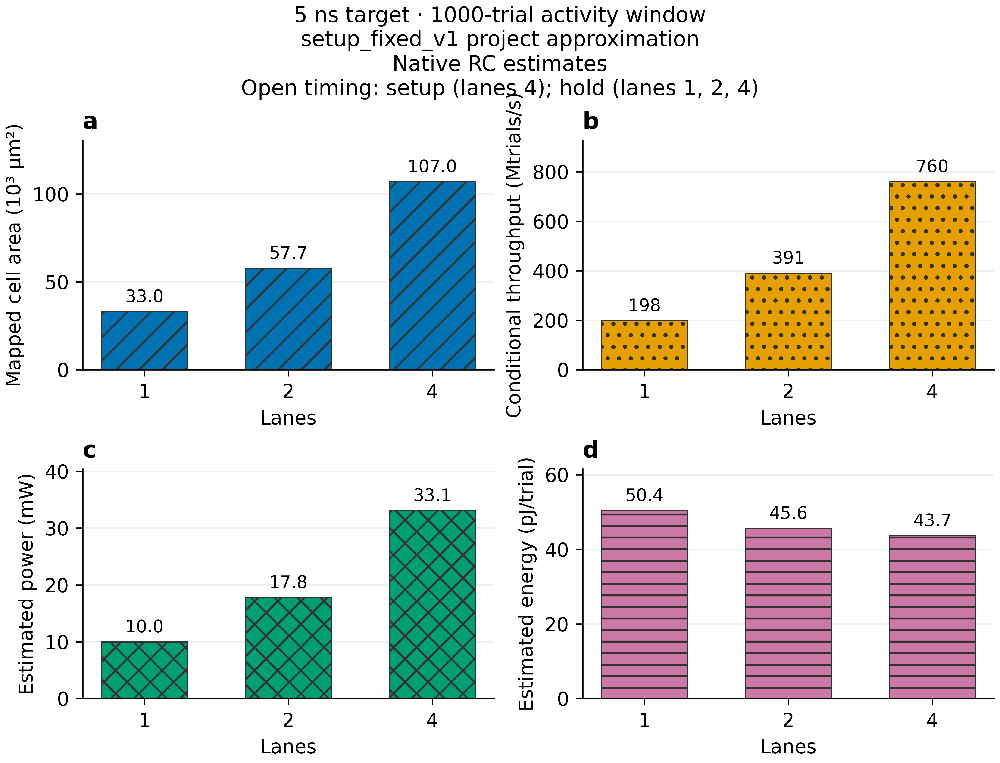
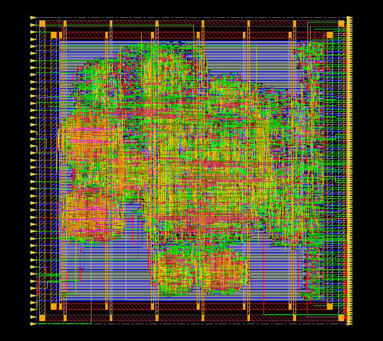

# Baseline with the versioned setup-table correction

Date: 2026-11-23. Implemented and validated by Chuanqi Chen.

PR #22 versions a project-specific DFFPOSX1 setup-table approximation and makes it
the default for DC, PrimeTime and Innovus. Both Liberty and compiled DB are in
Git, with their source, compiler provenance and paired checksums. Teammates
receive the same library by checking out or merging this change; normal runs
require no manual patching or library compilation. The original PR #21
[implementation baseline](Multilane_Implementation.md) remains separately recorded.

The instructor's guidance permits a documented project-specific correction.
This is an approximation of four anomalous entries, not new physical
characterization or confirmation of an STA software defect.

## Versioned correction and automatic selection

The [library package](../tech/gscl45nm/README.md) contains the original and
modified files, upstream Apache-2.0 license/notices, and exact reconstruction
metadata. At a fixed CLK transition, the rule uses two clean samples along the
D-transition axis:
`y = y0 + (x-x0)*(y1-y0)/(x1-x0)`.
Interior entries interpolate; boundary entries extrapolate from the nearest
two clean samples. Results are rounded to 12 decimal places in ns, ties to even.
This rule was recorded before inspecting timing improvements.

| Constraint | CLK / D transition (ns) | Original setup (ns) | Applied v1 approximation (ns) |
|---|---|---:|---:|
| rise | 0.30 / 0.06 | 6.200 | 0.153125 |
| rise | 0.30 / 0.90 | 5.125 | 0.1640625 |
| rise | 0.60 / 0.06 | 3.075 | 0.1453125 |
| fall | 0.30 / 0.48 | 5.850 | 0.310227272727 |

The values replace the rough examples in the email with a reproducible method.
The source validator verifies exactly four numeric changes and the required
modification notice; other source content is byte-preserved. LC T-2022.03-SP5
compiled both the unchanged source control and the modified library.

`mc_library` in the shared Tcl configuration selects the versioned pair and
checks both hashes. A changed Liberty file with a stale DB fails before use.
Explicit `LIB_DB` and `LIB_LIB` overrides remain available. The result collector
also rejects DC/PT library mismatches and mixed original/corrected DB–Liberty
pairs, preventing an accidental mixed baseline.
Overrides must supply both existing files; a half override fails before a tool
run. The installed/recompiled/fixed comparison supplies each DB with its
corresponding Liberty, including the unchanged original source for the control.

Selection is limited to the four previously identified multi-nanosecond
outliers. It is not a general monotonicity correction. Smaller irregular entries,
including rise CLK=0.6/D=0.9 at 0.59375 ns and fall CLK=0.06/D=0.48 at 0.49375 ns,
remain unchanged; the available evidence does not justify reconstructing them.

## Fixed-netlist experiment

The [nine-analysis comparison](../results/library_fixed_netlist.md) uses the
original PR #21 mapped netlist and exported SDC for each lane count, with fresh
PT processes for the installed, recompiled-original and corrected libraries.
Period, 0.10 ns clock transition, uncertainty, loads and typical corner remain
fixed. File hashes and all four rise/fall, min/max clock-transition settings
are verified by the comparison collector.

| Lanes | Installed PT setup (ns) | Recompiled-original PT setup (ns) | Corrected PT setup (ns) |
|---:|---:|---:|---:|
| 1 | -0.016767 | -0.016767 | +0.020597 |
| 2 | -0.046107 | -0.046107 | +0.033530 |
| 4 | -0.018574 | -0.018574 | +0.100237 |

All nine hold slacks are -0.041178 ns. The unchanged-source compilation control
reproduces the installed library's reported setup/hold slacks in these cases.
Thus the observed improvement in this experiment is attributable to the
four-entry edit. The corrected worst paths are in the RNG for the one- and
four-lane mappings and the controller for the two-lane mapping. The
[CSV](../results/library_fixed_netlist.csv) retains endpoints, setup requirements,
tool versions and input hashes. DFFPOSX1 path reports retain their pin transitions
and setup terms, including passing paths.

## New synthesis and routed baseline

All three designs were resynthesized and implemented using the corrected pair:
a10/k10, G=1, M=1, no retiming, 5 ns, typical 1.1 V / 27 C. The physical flow
retains 60% initial utilization, the same LEF/GDS, CTS targets, propagated clocks,
native RC method and original I/O/uncertainty constraints. It does not rebudget
I/O latency or waive reset checks.

| Lanes | DC area (µm²) | Pre-layout PT setup (ns) | Routed PT setup / hold (ns) | Innovus setup / hold (ns) | Estimated power (mW) |
|---:|---:|---:|---:|---:|---:|
| 1 | 33,033.558 | +0.020597 | +0.687440 / -0.025964 | +0.082 / +0.001 | 9.968 |
| 2 | 57,736.102 | +0.106786 | +0.538986 / -0.027642 | +0.030 / +0.000 | 17.8 |
| 4 | 106,959.101 | +0.100237 | +0.568867 / -0.025685 | -0.019 / -0.022 | 33.1 |

Innovus values are SI-aware post-route WNS, rounded to 1 ps in its summaries.
Positive routed setup is a PT result; Innovus still fails four-lane setup.
The generated tables retain both tools and the Innovus violation counts.

Pre-layout PT reports 121 / 238 / 470 hold-violation rows for 1/2/4 lanes.
The two-lane case additionally has 12 reset-removal rows at approximately
-0.016 ns: nine `active_seeds_reg_1__*/R` endpoints and the three
`cfg_k_reg_1_/R` through `cfg_k_reg_3_/R` endpoints. The routed reset
recovery/removal checks have no violations.

The [generated tables](../results/multilane_setup_fixed_v1.md),
[full CSV](../results/multilane_setup_fixed_v1.csv),
[synthesis CSV](../results/multilane_setup_fixed_v1_synthesis.csv), and
[run manifest](../reports/multilane_setup_fixed_v1_runs.csv) are the canonical
results. Resynthesis and physical optimization can change mapping, buffering
and placement; their resulting margins are distinct from the isolated
fixed-netlist experiment.



Mapped and routed replays each pass 81 cases / 82,489 completed trials across
the three lane counts. All three Innovus geometry/connectivity checks are clean
under the available LEF rules. Every internal and boundary pin-to-pin net has
an RC-network annotation. Power uses the same normal 1000-trial workload per
lane count and zero-delay gate activity; invariant activity points are 100%
annotated. The full table reports inferred/fully annotated cell coverage.



This image comes from the saved corrected-library one-lane Innovus database.
Raw reports, mapped/routed netlists, SDCs, compressed DEF/SPEF, library/source
hashes, compiler logs and activity-window metadata accompany the results.

## Remaining limits and integration

PT routed setup is positive; Innovus has a 19 ps four-lane setup miss.
PT hold still misses by approximately 26/28/26 ps. The worst hold paths are
short register-feedback loops with identical launch/capture clock paths, under
the unchanged 0.10 ns hold uncertainty. Add data-path delay with sufficient
margin and check both tools; clock-skew adjustment is not the primary remedy
for a loop that starts and ends at the same register.

PT reports 160 / 255 / 483 max-fanout rows after placement removes DC buffer
trees; the library supplies no fanout loads for Innovus to enforce the limit.
All 4,607 / 8,350 / 16,124 max-capacitance rows have zero required capacitance.
They arise at AOI21X1/Y, AOI22X1/Y, DFFSR/Q, NAND2X1/Y, NAND3X1/Y, NOR2X1/Y and
TBUFX1/Y, whose library limits are zero. No positive-limit capacitance check
violates. These rows remain violations; extra buffering cannot satisfy a
literal zero limit. Any revised limit needs a separate documented model change.

`RC-004` input-driver warnings remain. The kit has no characterized RC table,
and only the typical corner was studied. The tools' delay disagreement is an
additional limit: many routed loads and slews are below the Liberty lookup
grid. Off-grid evaluation is a plausible contributor, rather than an isolated
proof of an STA defect. These results do not establish physical signoff or a
rated maximum frequency.

Power, energy and target-rate throughput remain estimates under the stated
library, RC and activity assumptions. Functional replay does not substitute
for SDF timing simulation or foundry verification. Earlier standalone pricing
studies retain their original-library labels; this new baseline is for complete
1/2/4-lane tops.

Merge #21 before #22, or check out #22's stacked branch. Use the usual host
modules and Python environment, then choose fresh tags:

```bash
unset LIB_DB LIB_LIB  # select the versioned project defaults
make library-check
BATCH=my_fixed_syn make synth-multilane
SYN_BATCH=my_fixed_syn PNR_BATCH=my_fixed_layout make implement-multilane
```

To regenerate the published evidence from the archived reports:

```bash
python scripts/summarize_library_comparison.py \
  --manifest reports/library/setupfix_v1_20261123_ab2.csv \
  --out results/library_fixed_netlist
python scripts/parse_reports.py --syn reports/syn --filter setupfix_v1_20261123 \
  --out results/multilane_setup_fixed_v1_synthesis.csv
python scripts/summarize_multilane.py --manifest reports/multilane_setup_fixed_v1_runs.csv \
  --out results/multilane_setup_fixed_v1 --plot
```

The final PT tags retain full passing-path diagnostics. Reporting a larger slack
range changes report selection only; the SDC and measured slacks are unchanged.
The physical runner records export hashes automatically. Large GDS, Innovus
databases and VCDs remain at `/home/work/cc83382/course-libraryfix-20261123` on
peach, with their digests recorded. See the
[validation record](../reports/library_fix_validation_20261123.txt).
