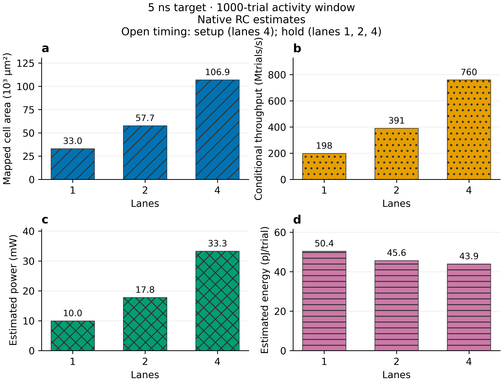
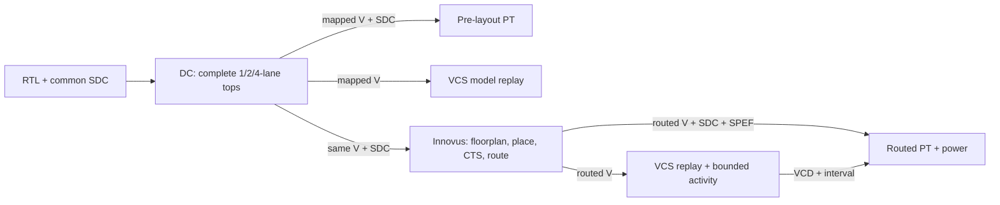
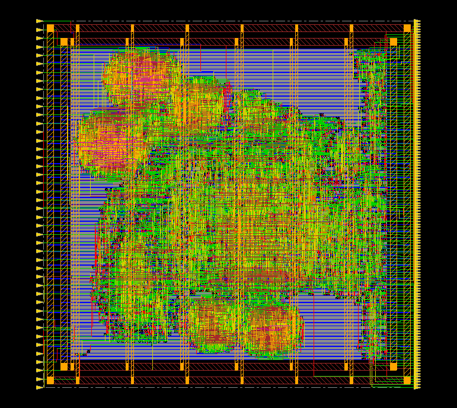

# Multi-lane implementation checkpoint

Date: 2026-11-23. Implemented and validated by Chuanqi Chen.

This document preserves PR #21's original-library checkpoint. The subsequent
[versioned library correction and new baseline](Library_Fix_Baseline.md) are
recorded separately; new shared-flow runs default to that versioned library.

This checkpoint provides complete 1/2/4-lane synthesis, matched Design Compiler
and PrimeTime analysis, and routed implementation evidence. All six mapped/routed
replays pass the corresponding model corpora. All three layouts pass Innovus's
available geometry and connectivity checks. Independent routed PT has positive
setup slack and remaining hold violations.
Innovus still fails four-lane setup. Its SI-aware post-route setup/hold WNS
is +0.018/-0.011, +0.076/-0.004 and -0.046/-0.049 ns for 1/2/4 lanes.
The generated results show both timing engines; positive PT setup alone does
not establish closure.

The canonical numbers are generated from archived reports:

- [Result tables](../results/multilane_implementation.md)
- [CSV with run IDs, annotation coverage and file digests](../results/multilane_implementation.csv)
- [Synthesis details, including electrical violations and unannotated power](../results/multilane_synthesis.csv)
- [Run-selection manifest](../reports/multilane_runs.csv)



The throughput panel assumes the 5 ns target. Energy uses the measured activity
window and estimated power. Neither establishes a timing-closed operating point.

## Common experiment

Each point is a complete `mc_top`: a10 Gaussian LUT, k10 exponential LUT,
`GAUSS_LATENCY=1`, `MUL_STAGES=1`, and retiming disabled. The lane count is the
architectural variable. DC and pre-layout PT consume the same mapped netlist and
exported SDC, with the same recorded `gscl45nm.db` digest.

The shared constraints retain the 5 ns clock, 30% I/O budgets, 0.1 ns clock
uncertainty/initial transition, reset recovery/removal checks, and electrical
limits. This measured baseline uses the installed, unmodified libraries and no
blanket reset false paths. The subsequently documented
[DFFPOSX1 setup-table investigation](PDK_Setup_Investigation.md) records the
professor's guidance and links to the completed project-local correction study;
no corrected-library results are included in these tables.



The lab versions are DC T-2022.03-SP2, PT T-2022.03-SP5 (PrimePower available),
VCS T-2022.06, and Innovus 21.18-s099_1 on peach. Synthesis starts from the merged
`4161ec7` RTL with the bounded-flow changes in `5749f3c`. The source manifests
record the exact scripts, inputs and installed technology assets used by each
phase.

## Physical implementation

The flow uses the installed OSU/FreePDK45 Liberty, LEF, standard-cell GDS files
and stream map. It creates a square floorplan at 60% initial utilization with
20 µm margins, M5/M6 power rings, M6 stripes, and signal routing on metals 1–10.
Clock-tree synthesis uses BUFX2/BUFX4 buffers with 0.1 ns transition/skew targets.
Actual clocks are propagated. Automatic I/O latency rebudgeting is disabled so
the original external clock reference is retained.

Post-route optimization uses Innovus's early/late analysis engine, required by
its SI optimizer. Both early and late use the same typical library with no
variation derates. This is a single-corner experiment. PT uses its independent
timing engine and nominal SPEF analysis; its reports are the independent check.



This image is exported directly from the saved one-lane routed database.
The run-selection manifest identifies the successful one-lane `try3` checkpoint
and the two/four-lane runs. They use the same final implementation Tcl and policy.
DEF and SPEF archives, routed Verilog/SDC, timing reports, geometry/connectivity
reports, and source/output digests accompany the results.

## Activity and functional validation

The interface replay checks exact payoff sum, count, flags and busy-cycle count,
including tails, illegal seeds, reset/restart, busy starts/writes and idle drain.
The mapped and routed corpora are identical for each lane count. A separate
negative replay flips one expected payoff bit and is rejected by VCS and the
runner. These are functional cell simulations with timing checks and specify
delays disabled; they do not constitute SDF timing simulation or formal
equivalence.

For power, the bench captures a normal 1000-trial case with the same A/B/K across
lane counts. The VCD covers start through completed pipeline drain, and the bench
records its exact start/stop times, clock period, case index and trial count.
PrimeTime reads only that interval and checks that the activity clock matches the
SDC. All synthesis-invariant activity points are annotated. The generated tables
also show the lower fraction of fully annotated leaf cells; remaining activity
is inferred by the tool.

The energy calculation is
`power_W × window_ns × 1000 / completed_trials` in pJ/trial.
The throughput calculation is
`1000 × trials / (busy_cycles × period_ns)` in Mtrials/s.
The capture window includes the start/sample boundary in addition to the busy
cycles, so the two denominators intentionally differ. Configuration/reset-release
time, host transfer, board power and workload variation are outside these figures.
The VCD has zero-delay activity and does not reproduce physical glitch timing.

## Remaining closure work

1. **Setup-table interpretation needs a controlled comparison.** The installed
   DFFPOSX1 setup table contains four verified outlying entries. The
   [investigation note](PDK_Setup_Investigation.md) separates the earlier
   clock-slew experiment from the fixed-SDC library correction. That
   [comparison is now recorded separately](Library_Fix_Baseline.md); positive
   PT routed setup slack here remains conditional on the installed library and
   native RC model. Innovus's four-lane setup miss is 46 ps.
2. **Hold timing remains unclosed.** Use the independent PT hold paths to guide
   further data-path buffering, then rerun both tools. The worst paths are
   single-register recirculation loops with identical launch/capture clocks;
   the 0.10 ns hold uncertainty makes these short paths fail. Moving the
   register's clock does not change its same-register skew. Lowering clock
   frequency alone does not repair a hold violation. Positive setup slack is
   insufficient to claim a working maximum frequency.
3. **RC accuracy is limited.** This installation supplies no characterized
   QRC technology file or capacitance table. Innovus reports `IMPEXT-6197` and
   uses its native estimates. Obtain a matching RC model and additional valid
   PVT corners before claiming physical performance or power signoff.
4. **Electrical limits remain violated.** PT reports max-capacitance and
   max-fanout violations. The capacitance rows are zero-limit library checks
   on seven output pins (AOI21X1/Y, AOI22X1/Y, DFFSR/Q, NAND2X1/Y, NAND3X1/Y,
   NOR2X1/Y, TBUFX1/Y); no positive-limit capacitance check violates. They
   remain reported and cannot be repaired by buffering to a literal zero
   limit. Placement's removal of DC buffer trees creates fanout violations;
   gscl45nm has no library fanout loads for Innovus to enforce the SDC limit.
   PT also reports `RC-004` warnings for
   several input-driver models, including non-positive drive resistance or
   inconsistent linear-driver data. Review these and the archived electrical,
   disabled-arc and timing-coverage reports with the shared library/constraints
   owner. The flow preserves the warnings and constraints.
5. **Verification scope is bounded.** Geometry/connectivity checks use the
   available LEF rules; no foundry DRC/LVS, extraction signoff, IR/EM or SDF
   timing closure is claimed. The reported power/energy is one representative
   workload at the target frequency, under the stated activity/RC assumptions.

All internal and boundary pin-to-pin nets have RC-network annotation. The
annotation reports separately list unannotated driverless nets. The result
collector requires complete pin-to-pin annotation and retains the driverless
counts.

## Reproduction and retained evidence

Use an owned lab checkout under `/home/work`, a login shell, and fresh batch tags:

```bash
module load syn/2022 cadence/2022
export PYTHON=/home/work/cc83382/venv/bin/python  # substitute your own environment
export LIB_DB="$PWD/tech/gscl45nm/original/gscl45nm.db"
export LIB_LIB="$PWD/tech/gscl45nm/original/gscl45nm.lib"
BATCH=study_001 make synth-multilane
SYN_BATCH=study_001 PNR_BATCH=layout_001 make implement-multilane
```

The synthesis gate accepts only 1/2/4 lanes. The physical sweep assumes the default
a10/k10/G1/M1 comparison. Runners reject existing run directories, missing PASS or
completion markers, tool errors after apparent success, and incomplete SDC reads.
The PT adapter retains the raw SDC and translates only the selected-design header
and the `get_designs {mc_top}` lookup to PT's already-linked design. The collector
independently checks that every other constraint is retained.

To regenerate the committed tables and plots on the laptop:

```bash
python scripts/parse_reports.py --syn reports/syn --filter implementation_20261123 \
  --out results/multilane_synthesis.csv
python scripts/summarize_multilane.py --plot
```

The collector checks matching netlist/SDC/SPEF/VCD digests, library/LEF identity
across points, completed tool logs, corpus counts, measured cycle records, power
units, SDC translation and RC annotation. For a new experiment, supply a
corresponding run-selection CSV with `--manifest`.

Large GDS files, Innovus databases, VCDs and compiler work files remain at
`/home/work/cc83382/course-implementation-20261123` on peach. GDS/output and VCD
digests are committed. SPEF/DEF are stored as deterministic gzip archives; their
digests refer to the uncompressed content. This checkpoint did not vendor
technology assets. PR #22 subsequently versions the Apache-licensed original and
corrected Liberty/DB pair; licensed EDA executables remain external.

The native layout image can be reproduced on the lab host:

```bash
PNR_DB="$PWD/reports/pnr/<tag>/mc_top.enc.dat" \
PNR_IMAGE="$PWD/reports/pnr/<tag>/fresh_layout.gif" \
  xvfb-run -a -s '-screen 0 1800x1200x24' innovus -files scripts/pnr/render.tcl
```

Validation commands and results are recorded in
[`reports/multilane_validation_20261123.txt`](../reports/multilane_validation_20261123.txt).
