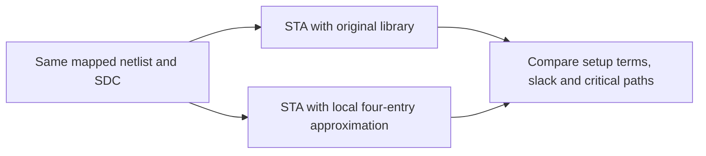

# DFFPOSX1 setup-table investigation

Recorded 2026-11-23 by Chuanqi Chen. Status: installed-library anomaly verified;
project-local correction proposed. PR #21's published measurements use the
installed library, with no project correction applied.

Professor Michael Orshansky's guidance, shared by Chuanqi, permits developing a
project-specific fix provided its method and effects are documented in the
report. This permits a documented approximation; it does not certify replacement
characterization values or establish an STA software defect.

## Verified library data

A read-only inspection of
`/usr/local/packages/FreePDK45/osu_soc/lib/files/gscl45nm.lib` confirms the four
reported entries on `DFFPOSX1/D`, `related_pin=CLK`,
`timing_type=setup_rising`. Time units are ns. The effective table axes are CLK
transition `0.06, 0.3, 0.6` and D transition
`0.06, 0.24, 0.48, 0.9, 1.2, 1.8`. The template defines these as
`related_pin_transition` and `constrained_pin_transition`, respectively.[^audit]

| Constraint | CLK transition (ns) | D transition (ns) | Installed value (ns) | Email proposal, approximate (ns) |
|---|---:|---:|---:|---:|
| rise | 0.30 | 0.06 | 6.200 | 0.11 |
| rise | 0.30 | 0.90 | 5.125 | 0.16 |
| rise | 0.60 | 0.06 | 3.075 | 0.21 |
| fall | 0.30 | 0.48 | 5.850 | 0.37 |

The proposed values are examples from the correspondence, not measured cell
characterization or results of a completed correction study. The audit retains
the surrounding table entries. These large local outliers support investigating
a characterization anomaly. Their effect depends on each endpoint's clock/data
transitions and edge polarity; it is not a uniform penalty on every DFFPOSX1.

The inspected Liberty and compiled-library SHA-256 values are:

```text
gscl45nm.lib  69c0641df1dc737e5c8dbd3950f2daf3b52c6e7767aa081e35e9b0739bf62d6f
gscl45nm.db   4968d1dba7ff9911cc51dfac7d8ea8b94fbab59d2f862f0531d7c774fb0a5791
```

They match all three PR #21 physical and routed-PT source manifests. The
[multi-lane tables](../results/multilane_implementation.md) therefore remain the
installed-library baseline.

## What the existing timing experiment establishes

The archived clock-slew experiment reports the following results for an earlier
one-lane mapping. “Pricing path” ends at
`u_lanes/u_price/acc_r_reg_0__32_`; the RNG path ends at
`u_lanes/u_rng/u_reg_31_`.[^slew]

| Clock transition (ns) | Pricing setup requirement (ns) | Pricing slack (ns) | RNG arrival (ns) | RNG slack (ns) |
|---:|---:|---:|---:|---:|
| 0.10 | 1.4177 | -0.2004 | 4.7539 | +0.0206 |
| 0.06 | 0.0829 | +1.1236 | 4.7573 | +0.0546 |

This is a clock-transition sensitivity experiment. Changing the slew affects
other cell timing as well: the RNG's DFFSR setup requirement changes from
0.1255 to 0.0880 ns, and pricing-path arrival changes from 3.6827 to 3.6935 ns.
The quoted approximately +0.05 ns RNG margin belongs to the 0.06 ns experiment.
Its 4.7573 ns arrival includes clock-to-Q and the following data path; it is not
pure combinational delay. The +1.1236 ns value is the pricing-path slack, not the
worst slack of the complete design.

The earlier matched DC/PT check separately shows approximately 1.22 ns versus
1.417704 ns for the pricing endpoint's setup requirement.[^interim] The PT slew
report gives D transition 0.0406 ns, below the table's minimum of 0.06 ns.
Lookup/extrapolation policy and actual pin slews need to be examined before
attributing the DC/PT discrepancy to an STA implementation defect.

The slew archive contains timing reports and a summary, but no corrected-library
manifest or fixed-slew original/corrected comparison. It establishes sensitivity
and a critical-path change under that diagnostic condition.

## Controlled project-local correction

The proposed comparison holds the mapped netlist, SDC, 5 ns period, 0.1 ns
pre-layout clock transition, uncertainty, loads, corner and tool settings fixed.
Use fresh tool processes and run tags for each library variant.



Record an explicit reconstruction rule, its input neighbours, rounding and every
old/new value before inspecting timing improvement. The two entries at
D transition 0.06 ns lie on the grid boundary, so their reconstruction requires
an explicit boundary or extrapolation assumption. “Interpolation of neighbours”
alone does not uniquely specify all four replacements. Report sensitivity to
reasonable alternative values where the choice affects the conclusion.

Create a derived Liberty copy in owned scratch space and verify that only the
four intended setup values changed. Preserve hold, recovery/removal, propagation,
power, area and electrical-limit data. Recompile both the unchanged Liberty
control and the derived copy using the same `lc_shell` version/options, recording
compiler logs and hashes. Comparing the rebuilt control with the installed `.db`
separates any library-compilation effect from the four-entry edit. The lab has
`lc_shell`; no corrected compilation or timing result is claimed in this note.

For each fixed-netlist analysis, retain the endpoint clock/data transitions,
edge polarity, setup requirement, arrival/required times, worst setup and hold,
coverage, and ranked critical paths. This establishes how the proposed table
change affects STA under the original assumptions. It does not by itself measure
the physical cell's correct setup time.

For a subsequent architectural comparison, rerun synthesis and implementation
for all 1/2/4-lane points using the corresponding derived `.db` in DC/PT and
derived `.lib` in Innovus. Preserve the existing baseline and use separate run
manifests and result filenames. Label the new results as using the documented
four-entry approximation and identify its hashes.

## Implications for integration and the course report

The RNG add/rotate/add path is a credible optimization candidate because it
becomes worst in the historical slew experiment. Its small pre-layout margin
does not alone determine post-route success or failure. Establish the critical
path and margin for the current design under the selected library and extracted
clock/routing model before deciding on an RTL change.

A four-entry setup correction does not directly repair the remaining hold,
max-capacitance or fanout violations, the input-driver `RC-004` warnings, or the
missing characterized RC table. Those remain separate closure items in the
[implementation checkpoint](Multilane_Implementation.md).

The final report should state the observed anomaly, the precise approximation,
the unchanged comparison assumptions, and the measured before/after results.
Use “timing under the documented corrected-library assumption” for those results.
Claims of true margins, a validated STA-tool bug, or physical signoff require
additional evidence.

[^audit]: [Read-only installed-library audit, 2026-11-23](../reports/dffposx1_setup_audit_20261123.txt). The log contains exact source-table excerpts, units and file digests; the installed files were not modified.
[^slew]: [0.10 ns slew report](../reports/sta/mc_top_shared_5ns_clkslew/setup_clkslew_0.10.rpt), [0.06 ns slew report](../reports/sta/mc_top_shared_5ns_clkslew/setup_clkslew_0.06.rpt), and [summary](../reports/sta/mc_top_shared_5ns_clkslew/summary.txt).
[^interim]: [Matched interim DC/PT discussion](Integration_Work_Plan.md#shared-5-ns-synthesis-and-independent-timing-results), with raw reports linked there.
