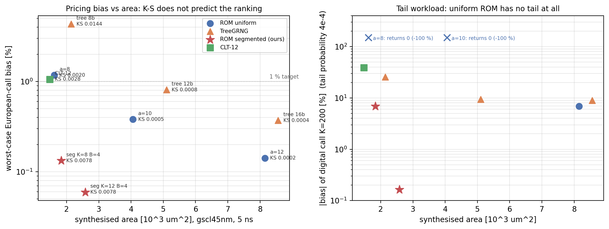

# Abstract (draft)

Hardware Gaussian random number generators (GRNGs) are evaluated with body-dominated statistics -
Kolmogorov-Smirnov (K-S) distance, moments, samples per second per mm^2 - yet their consumers in
Monte Carlo option pricing, rare-event estimation and Bayesian inference are governed by the tails.
We show, on one matched 45 nm standard-cell flow, that these statistics do not predict application
error: a 16-bit comparator-tree GRNG and a 512-entry inverse-CDF table have equal K-S (0.0004 vs
0.0005) and equal worst-case European-option bias (0.37 % vs 0.38 %), yet on a far-out-of-the-money
digital option the table returns exactly zero while the tree is within 9 %; a CLT-12 generator with
K-S 0.0028 misses the same tail by 39 %. We propose (i) an **exact, noise-free figure of merit** that
enumerates a generator's finite output distribution and propagates it through the fixed-point
consumer; (ii) a **closed-form bias bound** for truncated tables that explains 90 % of the measured
error and yields the 4x-per-two-address-bits sizing law; (iii) a **tail-refined segmented
inverse-CDF table** that allocates entries evenly in log-tail-probability via a leading-zero count,
which at 2,579 um^2 is 36 % smaller than the 512-entry uniform table while reducing worst-case bias
6.5x (to 0.059 %) and restoring the tail (+0.2 % on the digital option), and at equal entry count
cuts bias 9x; and (iv) a **matched comparison** of nine generator configurations - uniform tables,
segmented tables, comparator trees at three widths, and CLT - all bit-exact against their models
and synthesised with identical constraints. We also disclose and isolate a flip-flop
setup-table defect in the FreePDK45 library that distorts timing for every user of that PDK. All RTL,
models and flow scripts are released.

# 1. Motivation

Every GRNG paper we found (TreeGRNG DATE'24; compute-in-memory GRNGs DAC'26/TCAS'26; the Thomas &
Luk FPGA line; CLT and Box-Muller designs) reports K-S, chi-square or moments. The approximate-normal
Monte Carlo literature (Giles & Sheridan-Methven 2020-21; Haas & Giles 2025) analyses the bias of
cheap normals mathematically and removes it with a nested multilevel correction. Nobody compares
**hardware generator architectures** by the error of a **tail-sensitive downstream quantity** on a
**matched silicon flow**. Our course project happened to build the tooling to do exactly that.

# 2. What the prototype measured (Nov 2026)

All numbers: gscl45nm (FreePDK45), Design Compiler, 5 ns, typical corner, one SDC; accuracy by exact
enumeration (tables, CLT) or 4M-cycle RTL histogram (trees); bias through the same fixed-point lane.

| Generator | Entries / width | Area um^2 | K-S | Worst call bias | Digital K=200 (p = 4e-4) |
|---|---|---:|---:|---:|---:|
| uniform ROM a=8 | 128 | 1,618 | 0.0020 | 1.178 % | returns 0 (-100 %) |
| uniform ROM a=10 | 512 | 4,060 | 0.0005 | 0.381 % | returns 0 (-100 %) |
| uniform ROM a=12 | 2,048 | 8,152 | 0.0002 | 0.142 % | +6.8 % |
| TreeGRNG 8 b | INT8 | 2,144 | 0.0144 | 4.33 % | -25.5 % |
| TreeGRNG 12 b | 12 b | 5,099 | 0.0008 | 0.81 % | -9.3 % |
| TreeGRNG 16 b | 16 b | 8,562 | 0.0004 | 0.37 % | -9.0 % |
| CLT-12 | 12 words | 1,475 | 0.0028 | 1.06 % | -39 % |
| **segmented K=8 B=4 (ours)** | 128 | 1,832 | 0.0078 | **0.133 %** | +6.8 % |
| **segmented K=12 B=4 (ours)** | 192 | **2,579** | 0.0078 | **0.059 %** | **+0.2 %** |

Three observations carry the paper:

1. **K-S mis-ranks.** Equal K-S, equal European bias, opposite tail behaviour (ROM-10 vs Tree-16);
   the segmented table has 4x *worse* K-S than uniform a=8 and 9x *better* bias.
2. **Failure modes are complementary.** Uniform tables: exact body, no tail beyond |z|max.
   Trees and CLT: tail mass present, body distorted. Neither is acceptable on both workloads.
3. **The segmented table dominates** every other point on both panels; residual bias (0.06 %) is
   the datapath's register-rounding floor, not the table.

# 3. Contributions and status

| # | Contribution | Status |
|---|---|---|
| C1 | Exact application-level FoM (`model/grng_fom.py`) | Done; two workloads |
| C2 | Tail-truncation bias bound (`model/bias_bound.py`): 89-91 % of exact bias at a = 6..12 | Done; derivation to write up |
| C3 | Segmented table: model, RTL (clz + case ROM), bit-exact TB, DC | Done |
| C4 | Matched comparison, nine configurations | Done pre-layout; P&R + activity-based energy to add |
| C5 | FreePDK45 `DFFPOSX1` setup-table defect, isolated by PT sensitivity run | Done; HSPICE re-measurement pending TA |
| C6 | Open-source release | Branch exists; clean-up |

# 4. Remaining work before submission

| Item | Weeks | Purpose |
|---|---|---|
| Exact enumeration of the comparator tree (replace histograms) | 1 | Make C1 exact for all architectures |
| Box-Muller point; 16-bit tree with tuned thresholds (authors' generator permits) | 1 | Fairness to competing designs |
| Innovus P&R of the generators; SAIF-based energy per sample | 2 | Energy axis; post-layout numbers |
| Bias bound write-up; position vs Giles & Sheridan-Methven; MLMC-correction cost comparison | 1 | Theory and related work |
| Segmented table in the full lane (A/D/E-style sweep) | 1 | System-level evidence |
| Writing, figures, artifact | 2 | Draft |

# 5. Venues and timeline

| Venue | Deadline (approx., confirm on CFP) | Role |
|---|---|---|
| **ICCAD 2027** | abstract ~mid-April 2027, paper ~late April | Primary (ASIC, 8 pages); notification ~late July |
| **FPL 2027** | ~early/mid March 2027 | Alternative: add Vivado implementations of all generators and the post-placement optimisation flow from the DAC 2027 submission; engages the FPGA GRNG and Haas & Giles lines directly |
| TCAS-I / TVLSI | rolling | Full-length landing spot either way (extension of ICCAD, or direct in Aug 2027) |
| DATE 2028 | ~Sept 2027 | Fallback; TreeGRNG's own venue |

Recommendation: one ICCAD paper with a cross-platform FPGA section unless the FPGA results carry a
contribution of their own (e.g. the post-placement pass changes the ranking), in which case FPL +
ICCAD/TCAS-I with disjoint claims.

# 6. Risks

- Giles' approximate-normal analysis may already contain the piecewise-constant tail term;
  C2 then becomes "hardware form of" - C1, C3, C4 stand.
- A 16-bit tree with tuned thresholds may close part of the gap; the complementary-failure
  argument and the segmented table's tail behaviour do not depend on it.
- Academic PDK, pre-layout numbers so far; matched flow and disclosed library defect are the defence.
- Authorship: course-project origin (flow: T. Haverlah; datapath: E. Goode; RNG: S. Zhong) - agree early.

# 7. Questions for the advisor

1. ICCAD-first or journal-first?
2. One paper with an FPGA section, or FPL + ICCAD pair?
3. Co-authorship and advising.
4. Releasing a corrected `gscl45nm.lib` for the course.
