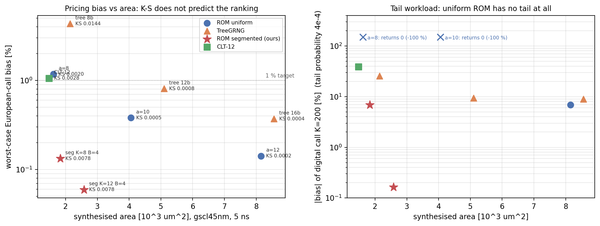

# Abstract (draft)

Hardware Gaussian random number generators (GRNGs) are judged by body-dominated statistics -
Kolmogorov-Smirnov (K-S) distance, moments, samples per second per mm^2 - while their consumers in
Monte Carlo pricing, rare-event estimation and Bayesian inference are governed by the tails. We
show on one matched 45 nm standard-cell flow that these statistics do not predict application
error and can invert the ranking: a 16-bit comparator-tree GRNG and a 512-entry inverse-CDF table
have equal K-S and equal worst-case European-option bias, yet on a far-out-of-the-money digital
option the table returns exactly zero while the tree is within 9 %; a dyadic table with 4x *worse*
K-S than a uniform one has 9x *lower* pricing bias; and the L2-optimal piecewise-linear
approximation of Giles and Sheridan-Methven has lower K-S but 3.2x higher bias than a
piecewise-constant table of the same intervals. We contribute (i) an **exact, noise-free
application-level figure of merit** that enumerates a generator's finite output distribution -
including, for comparator trees, a probed selection map that reveals the shipped design deviates
from its own product-form intent through LFSR period dependence; (ii) the **weak-error (payoff
bias) counterpart** of Giles and Sheridan-Methven's strong-error bound for equal-interval tables,
whose tail term explains 90 % of the measured bias and yields a 4x-per-two-address-bits sizing
law; (iii) a **multiplier-free hardware realisation of the dyadic-interval table** - a 31-bit
leading-zero count selecting 2^B stored cells per band - which at 2,579 um^2 is 36 % smaller than
the 512-entry uniform table with 6.5x lower bias and restored tails, and 1.7x smaller than the
piecewise-linear form with 3.2x lower bias; and (iv) a **matched comparison of fourteen generator
configurations** (uniform, dyadic-constant and dyadic-linear tables; comparator trees at three
widths including best-tuned variants; CLT-12), all bit-exact against their models and synthesised
under identical constraints. We also disclose a flip-flop setup-table defect in the FreePDK45
library that distorts timing for every user of that PDK. RTL, models and flow are released.

# 1. Positioning after the prior-art review

Giles & Sheridan-Methven (arXiv 2012.09715, 2022) already define the equal-interval
piecewise-constant table (their Thm 2.3) and a piecewise-linear table on dyadic intervals indexed
by the float exponent (Thm 2.5), and bound their **strong** (L^p) error; application bias is then
removed by nested MLMC (2102.08164; Haas & Giles 2025 on FPGA). The GRNG hardware literature
(TreeGRNG DATE'24, CIM GRNGs DAC'26/TCAS'26, Thomas & Luk) optimises K-S and GSa/s/mm^2.

What is new here is therefore **not the dyadic-interval idea** but: the figure of merit and the
inversions it exposes; the weak-error form of the bound; the multiplier-free hardware realisation
and its measured dominance on silicon - including over the Giles form itself; and the matched
cross-architecture comparison. The paper says so explicitly.

# 2. Evidence in hand (all on gscl45nm, DC, 5 ns, one SDC)

| Generator | Area um^2 | K-S | Worst call bias | Digital K=200 (p=4e-4) |
|---|---:|---:|---:|---:|
| uniform ROM a=8 / a=10 / a=12 | 1,618 / 4,060 / 8,152 | .0020 / .0005 / .0002 | 1.18 / 0.38 / 0.14 % | 0 / 0 / +6.8 % |
| TreeGRNG 8 b / 12 b / 16 b | 2,144 / 5,099 / 8,562 | .0144 / .0008 / .0004 | 4.33 / 0.81 / 0.37 % | -26 / -9 / -9 % |
| TreeGRNG 16 b best-tuned | 9,963 | .0007 | 0.21 % | -1.1 % |
| CLT-12 | 1,475 | .0028 | 1.06 % | -39 % |
| PWL dyadic K=12 F=12 (Giles form, 16x12 mult.) | 4,387 | .0051 | 0.19 % | -0.6 % |
| **dyadic-constant K=8 B=4 (ours)** | 1,832 | .0078 | **0.13 %** | +6.8 % |
| **dyadic-constant K=12 B=4 (ours)** | **2,579** | .0078 | **0.059 %** | **+0.2 %** |

Supporting measurements: bias bound explains 89-91 % of exact table bias at a = 6..12
(`model/bias_bound.py`); exact comparator-tree enumeration from a probed mux map matches the RTL
histogram to K-S 0.013 vs 0.014 with a real residual from LFSR period dependence
(`model/treegrng_exact.py`); all tables bit-exact in RTL at two latencies.

# 3. Contributions

| # | Contribution | Status |
|---|---|---|
| C1 | Exact application-level FoM; two workloads; probed-map enumeration for trees | done |
| C2 | Weak-error bias bound (counterpart of G&S-M Thm 2.3), tail/body decomposition, sizing law | measured; derivation to write |
| C3 | Multiplier-free dyadic table in hardware; dominance over uniform, tree, CLT, and the PWL dyadic form | done pre-layout |
| C4 | Matched comparison, fourteen configurations | done pre-layout; P&R + activity energy to add |
| C5 | FreePDK45 `DFFPOSX1` setup-table defect isolated | done; HSPICE re-measurement pending |
| C6 | Open-source release | branch; clean-up |

# 4. Remaining work

| Item | Weeks |
|---|---|
| Bound derivation using G&S-M lemmas 2.1-2.2 (closed form); related-work section | 1 |
| 16-bit tree exact enumeration (extend probe TB); Box-Muller point | 1 |
| Innovus P&R; SAIF energy per sample for all generators; lane-level sweep with the dyadic table | 2 |
| MLMC-correction cost comparison on the lane (their remedy vs ours) | 1 |
| Writing, figures, artifact | 2 |

# 5. Venues

| Venue | Deadline (approx.) | Role |
|---|---|---|
| **ICCAD 2027** | ~mid/late April 2027 | primary (ASIC, 8 pp) |
| **FPL 2027** | ~March 2027 | alternative: Vivado implementations + the DAC'27 post-placement flow; direct engagement with Haas & Giles |
| TCAS-I / TVLSI | rolling | full-length landing spot |
| DATE 2028 | ~Sept 2027 | fallback |

# 6. Risks - updated

| Risk | Status after R1-R4 |
|---|---|
| Giles has the table construction | **Materialised and absorbed**: cited as the origin of the dyadic table; our claims are the FoM, the weak-error bound, the multiplier-free hardware form and its measured dominance - including over their own PWL form (1.7x area, 3.2x bias). |
| Tuned tree closes the gap | **Closed by measurement**: best-tuned 16-bit tree is 3.6x the bias at 3.9x the area. |
| Histogram vs exact | **Closed for 8-bit** via the probed map (and it found a real LFSR-dependence effect); 16-bit extension is mechanical. |
| Academic PDK, pre-layout | matched flow; P&R planned; library defect disclosed. |
| Authorship | course-project origin (flow: T. Haverlah; datapath: E. Goode; RNG: S. Zhong); agree early. |

# 7. Questions for the advisor

1. ICCAD-first or journal-first?  2. One paper with an FPGA section, or FPL + ICCAD?
3. Co-authorship and advising.  4. Releasing a corrected `gscl45nm.lib` for the course.
