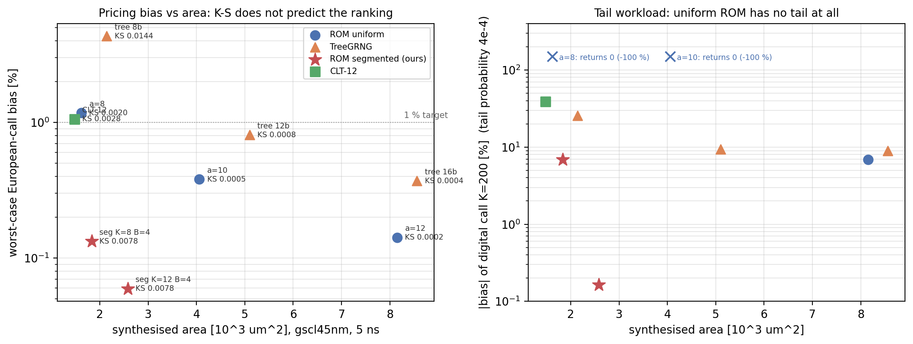

# Abstract (draft)

Hardware Gaussian random number generators (GRNGs) are judged by body-dominated statistics -
Kolmogorov-Smirnov (K-S) distance, moments, samples/s/mm^2 - while Monte Carlo option pricing is
governed by the tails. On one matched 45 nm standard-cell flow we show that these statistics do
not predict pricing error and can invert the ranking: a 16-bit comparator-tree GRNG and a
512-entry inverse-CDF table have near-equal K-S (0.0004 vs 0.0005) and near-equal worst-case
European-call bias (0.37 vs 0.38 %), yet on a far-out-of-the-money digital option the table
returns exactly zero while the tree is within 9 %; a dyadic table with 4x worse K-S than a
uniform one of equal size has 9x lower pricing bias. We contribute (i) an **application-level
figure of merit**: the downstream bias computed as an exact expectation over the generator's
output distribution - enumerated analytically for tables and CLT, and for comparator trees from
a probed selection map that also reveals the shipped design deviates from its product-form
intent through LFSR-period dependence; (ii) an **exact tail/body decomposition** of the uniform
table's pricing error, the weak-error companion of Giles and Sheridan-Methven's strong-error
result, whose closed-form tail term accounts for 89-91 % of the measured bias at every table
size and gives a 4x-per-two-address-bits sizing rule; (iii) a **multiplier-free hardware form of
the dyadic-interval table** (31-bit leading-zero count selecting 2^B stored cells per band)
which, pre-layout and with the uniform source included, is the smallest generator at any bias
below 0.2 %: 7.9k um^2 vs 9.3k for the 512-entry uniform table (6.5x the bias), 9.7k for the
piecewise-linear dyadic form of Giles and Sheridan-Methven (3.2x the bias), and 10.0k for the
best comparator tree we could tune (3.6x the bias); and (iv) a **matched comparison of fifteen
generator configurations**, all bit-exact against their models, synthesised under one constraint
set, with a sensitivity re-synthesis showing a known FreePDK45 flip-flop library defect shifts
area by at most 5 % and no rankings. Post-layout area and activity-based energy are the next
step and are not claimed here. RTL, models and flow are released.

# 1. What is new, and what is not

Giles & Sheridan-Methven (2022) define the equal-interval table and the dyadic-interval
piecewise-linear table indexed by the float exponent, and bound their **strong** error; they
remove application bias with nested MLMC. The GRNG hardware literature optimises K-S and
throughput per area. Ours: the figure of merit and the ranking inversions it exposes; the
weak-error decomposition; the multiplier-free hardware form and its measured position on the
area-bias front; the fifteen-way matched comparison. **Not ours:** the dyadic-interval idea, the
comparator tree, the CLT.

# 2. Evidence (gscl45nm, Design Compiler, 5 ns, one SDC, pre-layout; K-S is the two-sided discrete supremum)

Accounting boundary: every generator needs uniform bits. Tables and PWL consume one 32-bit
xoshiro128++ word per sample (`rng_lane`, 5,275 um^2); CLT-12 consumes 144 bits = 4.5 words;
TreeGRNG embeds its own LFSRs. Both generator-only and source-inclusive areas are given.

| Generator | Distribution | Gen. um^2 | +source um^2 | K-S | Worst call bias | Digital K=200 (p = 4e-4) |
|---|---|---:|---:|---:|---:|---:|
| uniform ROM a=8 / 10 / 12 | enumerated | 1,618 / 4,060 / 8,152 | 6.9k / 9.3k / 13.4k | .0020 / .0005 / .0002 | 1.18 / 0.38 / 0.14 % | 0 / 0 / +6.8 % |
| TreeGRNG 8 b | enumerated (probed map) | 2,144 | 2.1k | .0128 | 3.73 % | -19 % |
| TreeGRNG 12 b / 16 b | 4M-cycle RTL histogram | 5,099 / 8,562 | 5.1k / 8.6k | .0008 / .0004 | 0.81 / 0.37 % | -9 / -9 % |
| TreeGRNG 16 b, best among 4 tuned variants | histogram | 9,963 | 10.0k | .0007 | 0.21 % | -1.1 % |
| CLT-12 (adder tree only) | enumerated | 1,475 | 25.2k | .0028 | 1.06 % | -39 % |
| PWL dyadic K=12 F=12 (G&S-M form, 24 coeff. + 16x12 mult.) | enumerated | 4,387 | 9.7k | .0051 | 0.19 % | -0.6 % |
| **dyadic-constant K=8 B=4 (ours, 128 cells)** | enumerated | 1,832 | 7.1k | .0078 | **0.13 %** | +6.8 % |
| **dyadic-constant K=12 B=4 (ours, 192 cells)** | enumerated | **2,579** | **7.9k** | .0078 | **0.059 %** | **+0.2 %** |

Throughput and latency: every design produces one sample per cycle (II = 1); tables, PWL and CLT
have one output register (latency 1; a 2-stage option is implemented and verified for the tables);
TreeGRNG's output is combinational from its LFSR registers (latency 0). Pre-layout Fmax at the
5 ns constraint: 200-222 MHz for all; none is throughput-limited at the lane's 200 MHz.

Library-defect sensitivity: re-synthesising with the clock transition on the clean row of the
`DFFPOSX1` setup table changes area by -4.7 % (dyadic-constant, 2,458 um^2), -3 % (PWL), and
< 0.5 % (uniform, tree, CLT). No ranking changes.

# 3. Findings the reviewers asked us to state precisely

1. **Degrees of freedom vs hardware cost.** At matched parameter count (24 stored values) the
   piecewise-linear form is far more parameter-efficient (0.19 % vs 1.26 % for 24 constant
   cells). The dyadic-constant table wins on *area*, not on approximation power: 192 cells
   (2,579 um^2) cost less than 24 coefficients plus a 16x12 multiplier (4,387 um^2) and give 3.2x
   lower bias. We no longer claim "L2-optimal is not bias-optimal" as a general statement; we
   report the measured hardware trade-off.
2. **"Exact" means exact expectation over a stated distribution.** Tables, CLT and the 8-bit tree
   are analytically enumerated; the 12/16-bit trees are 4M-cycle RTL histograms (per-code SE
   ~5e-5). The 8-bit enumeration matches its histogram to K-S 0.013 vs 0.014; the residual is
   genuine LFSR-period dependence (255 and 1023 share a factor) - the shipped design does not
   realise its own product-form distribution.
3. **The tail/body decomposition (C2) is a decomposition, not yet a theorem.** The tail term is
   an exact integral expression for the error of collapsing the tail onto the last cell; the
   body term is the midpoint-quantisation remainder, measured (9-11 %). A bound with explicit
   constants for convex payoffs of at most exponential growth, using G&S-M lemmas 2.1-2.2, is
   the stated remaining theory work.
4. **Scope of the application claim.** Workloads are a five-point European-call grid and three
   digital strikes at S0 = 100, r = 0.05, sigma = 0.2, T = 1. The 1 % figure is the project's
   deterministic-bias budget, set so that bias stays below one run's sampling noise at 2^20
   trials (0.08-0.35 %, `results/price_vs_bs.csv`); the paper will report finite-run error
   (bias + sampling) across trial counts. Claims about rare-event estimation and Bayesian
   inference are removed; the digital call *is* a tail-probability estimator and is the evidence
   for that class.

# 4. Contributions and status

| # | Contribution | Status |
|---|---|---|
| C1 | Application-level FoM; two workloads; probed-map enumeration for trees | done (8 b exact; 12/16 b histograms) |
| C2 | Exact tail/body decomposition of uniform-table pricing error; sizing rule | measured; theorem to write |
| C3 | Multiplier-free dyadic table; position on the area-bias front vs 14 alternatives, both accounting boundaries | done pre-layout |
| C4 | Matched comparison, library-defect sensitivity | done pre-layout |
| C5 | FreePDK45 `DFFPOSX1` setup-table defect: isolated, sensitivity quantified | HSPICE re-measurement pending |
| C6 | Open-source release | branch; clean-up |

# 5. Remaining work (before submission)

| Item | Weeks | Addresses |
|---|---|---|
| Innovus P&R of the principal points; SAIF energy/sample; routed area and timing | 2 | R3, R5 |
| 16-bit tree exact enumeration (extend probe TB); bias-optimised PWL fit; Box-Muller point | 1.5 | R2, R3 |
| C2 theorem with constants; finite-run error study across trial counts; workload sensitivity (sigma, T, K) | 1.5 | R1, R2, R4 |
| Nested-MLMC correction cost vs table refinement at matched RMSE on the lane | 1 | R2 |
| Writing, figures, artifact | 2 | - |

# 6. Venues

ICCAD 2027 (primary, ~April 2027); FPL 2027 (alternative with FPGA implementations and the
DAC'27 post-placement flow, ~March 2027); TCAS-I/TVLSI (rolling, full length); DATE 2028 (fallback).

# 7. Risks

| Risk | Status |
|---|---|
| Dyadic-table construction is prior art | credited; our claims are FoM, decomposition, hardware form, comparison |
| PWL fitted for bias could narrow the gap | acknowledged; bias-optimised fit scheduled; the multiplier cost (1,800 um^2) remains |
| Pre-layout only | stated in every table; P&R scheduled; defect sensitivity <= 5 % |
| Tree "best-tuned" | relabelled "best among four tuned variants"; grid documented |
| Authorship | course-project origin; agree early with advisor and teammates |
